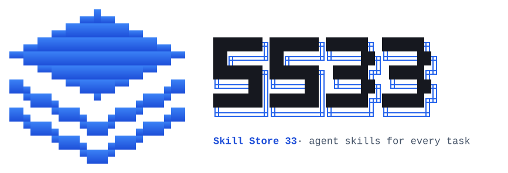

<picture>
  <source media="(prefers-color-scheme: dark)" srcset="assets/header-dark.svg">
  
</picture>

# ss33 Skill Store for agents

[](https://github.com/afterpartyai/ss33-skill-store-for-agents/actions/workflows/ci.yml)
[](https://github.com/afterpartyai/ss33-skill-store-for-agents/releases/latest)
[](#supported-agents)
[](package.json)
[](LICENSE)

> **Public beta.** Things may change between versions, and prompt-matching suggestions are still being tuned. Feedback is welcome (see [Support](#support)).

Use the [ss33 Skill Store](https://ss33.ai) from your coding agent without spending model tokens on searching:

- **search** finds skills that fit *this* project. A short summary of the stack goes with the search: package manager, versions, services. It's built from manifest files only, never your source code.
- **add** reviews a skill with you, then installs it as a native skill (`<skills folder>/<name>/SKILL.md`), pinned in `ss33.lock` so your team gets the same version.
- **Skill sets:** some searches also return a set of skills used together for one job (for example plan, draw, then check). Adding a set installs each of its skills, and each one notes its step so your agent knows the order.
- **update** shows what changed upstream and applies updates only when you say so. It never overwrites your local edits without asking.
- **Prompt matching** (off by default, opt in): if a published skill clearly fits what you just asked, you see a one-line note suggesting it. At most a few per session. It sends your prompt to the store (see [Privacy](#privacy)).

## Supported agents

| Agent | Commands look like | Skills install to | Prompt matching | Install |
|---|---|---|---|---|
| Claude Code | `/ss33:search` | `.claude/skills/` | ✓ | [below](#claude-code) |
| Codex | `$ss33:search` | `.agents/skills/` | ✓ | [below](#codex) |
| Hermes Agent | `/ss33:search` | `.agents/skills/` | ✓ | [below](#hermes-agent) |
| Cursor (app and CLI) | `/ss33-search` | `.agents/skills/` | not available in Cursor | [below](#cursor) |
| GitHub Copilot (CLI and VS Code) | `/ss33:search` | `.agents/skills/` | ✓ (the agent passes it on) | [below](#github-copilot) |
| DeepSeek Harness (DSH) | `/ss33-search` | `.agents/skills/` | ✓ | [below](#deepseek-harness-dsh) |

The rest of this page writes commands the Claude Code way (`/ss33:add`). Use your agent's form.

ss33 runs on Node.js but needs no install. It uses your Node.js if it's version 22 or newer. Otherwise it downloads the official build once (about 30 MB, checked against a pinned checksum) into `~/.cache/ss33/runtime`, in the background when your first session starts. On Windows, Cursor and Copilot need [Git for Windows](https://git-scm.com/download/win); ss33 finds its `sh.exe` even when it isn't on your PATH.

## Install

### Claude Code

```
/plugin marketplace add afterpartyai/ss33-skill-store-for-agents
/plugin install ss33@ss33
```

Claude Code asks for the API key and the prompt-matching switch when you install. Change them later with `/plugin configure ss33@ss33`. To get updates automatically, turn on auto-update for the `ss33` marketplace under `/plugin` → Marketplaces (it's off by default for marketplaces other than Anthropic's).

### Codex

Needs Codex 0.164 or newer (tested with 0.164 and 0.167):

```
codex plugin marketplace add afterpartyai/ss33-skill-store-for-agents
codex plugin add ss33@ss33
```

Start a new session and run `$ss33:setup`. Codex will say **"Hooks need review"**: trust the two ss33 hooks (or review them in `/hooks`), otherwise prompt matching can't run. Codex asks again after every plugin update.

- **Approvals:** Codex's sandbox blocks network access and keeps `.agents/` read-only, so Codex asks before each ss33 command. Allow the `sh …/scripts/ss33` prefix to stop being asked.

### Hermes Agent

Needs Hermes 0.22.3 or newer (tested with 0.23.2):

```
hermes plugins install afterpartyai/ss33-skill-store-for-agents/adapters/hermes --enable
```

Start a new session inside a project and run `/ss33:setup`. Hermes uses its own Node.js for ss33 when it has one.

- **Commands** work in the interactive terminal, TUI and desktop app. They don't work in `hermes chat -q` or in chat apps (Telegram, Slack, …). They also need the local terminal backend (not docker, modal, …).
- **Search tool:** the agent can also search the store itself with the `ss33_search` tool. It suggests `/ss33:add <ref>` rather than installing anything.
- **Trust:** Hermes loads project skills only from repos you trust. Run `hermes skills trust` in the repo once.
- **Prompt matching** only runs in sessions inside a project. It never runs for prompts from chat apps unless you also turn on `match.chatApps`.

### Cursor

Works in the Cursor app and the Cursor CLI (`agent`, tested with 2026.11.22):

```
agent plugin marketplace add https://github.com/afterpartyai/ss33-skill-store-for-agents
```

Then, in `agent`, install `ss33` from `/plugins` → Marketplace. In the app, paste the repo URL into the plugin search instead. Start a new chat and run `/ss33-setup`.

- **No prompt matching:** Cursor's prompt hook can't add a note for the agent. The agent can still search the store on its own when a task needs a specialised procedure.
- **Approvals:** Cursor asks before each ss33 command, and a plugin can't pre-approve its own commands (allowlisting `sh` doesn't cover them either). Approve them as they come, or use auto-review mode (`agent --auto-review`), which runs commands Cursor judges safe without asking.

### GitHub Copilot

Works in the Copilot CLI (tested with 1.0.114) and Copilot chat in VS Code:

```
copilot plugin marketplace add afterpartyai/ss33-skill-store-for-agents
copilot plugin install ss33@ss33
```

Start a new session and run `/ss33:setup`.

- **Prompt matching:** Copilot can't show you a note from a plugin, so when a published skill clearly fits, the agent mentions it in one line at the end of its reply.
- **Approvals:** Copilot asks for access to the plugin's folder (choose to remember it for the session), then before each ss33 command.
- **VS Code:** Copilot chat in VS Code installs the same plugin with `/plugin marketplace add` (tested on Windows 11).

### DeepSeek Harness (DSH)

Works in DSH 0.2.2 and later. Add it to a profile (here `web`; use the profile you run):

```
dsh plugin --profile web add "github:afterpartyai/ss33-skill-store-for-agents#path:adapters/dsh"
```

This needs `pnpm` on your PATH. Restart DSH, start a new session and run `/ss33-setup`.

- **Sandbox:** ss33 commands run in DSH's shell sandbox. Searching needs network access to `mcp.ss33.ai`. Settings commands write `~/.config/ss33`, outside your workspace, so DSH may ask you to approve them.
- **Prompt matching:** the note appears in the conversation, collapsed to one line.

## Settings

**API key** (optional). The free tier allows 5 searches a minute. Create a key at https://ss33.ai/skills/account for more. Never paste the key into the chat. Set it where your agent keeps plugin settings:

| Agent | Where to set the key |
|---|---|
| Claude Code | `/plugin configure ss33@ss33` (stored in your OS keychain) |
| Hermes Agent | In the desktop app (Settings → Plugins → ss33), or as `SS33_API_KEY=<key>` in `~/.hermes/.env` |
| Codex, Cursor, Copilot, DSH | These have no plugin settings screen. In your own terminal, run the `config set apiKey` command that `setup` shows you |

Every route ends up in `~/.config/ss33/config.json` (0600), which all the ss33 commands read. An `SS33_API_KEY` environment variable also works where your agent passes it through. Codex may not: its background server may have started before you set it. `/ss33:setup` checks that the store accepts the key.

**Prompt matching:** turn it on or off with `/ss33:setup`, or in Claude Code with `/plugin configure`.

## Commands

| Command | What it does |
|---|---|
| `/ss33:search <task>` | Search the store (the agent may also use this on its own for specialised tasks) |
| `/ss33:add <ref>` | Preview, review and install a skill, or every skill in a set (`skill-set/…` ref) |
| `/ss33:update [name…]` | Check for and apply updates |
| `/ss33:list` | Installed skills, and whether their files still match the lock |
| `/ss33:setup` | Show settings, check that the store accepts your key, and explain any problems |

Installed skills load as ordinary skills (`/<name>`, or `$<name>` in Codex). Start a new session if one doesn't appear. Commit the skill folder and `ss33.lock` so your team gets the same pinned version.

A set's skills are installed and updated like any other skill. `/ss33:list` shows which set and step each came from, and `ss33 remove skill-set/…` removes them all.

### Command-line tool

The same operations are available as a CLI: `ss33 search | add | update | remove | list | fingerprint | config | doctor`. Run `ss33 help` for details. The plugins run it for you. To use it in your own terminal, install it globally (this needs Node.js ≥ 22 and npm):

```
git clone https://github.com/afterpartyai/ss33-skill-store-for-agents.git
npm install -g ./ss33-skill-store-for-agents
```

This links to the clone, so `git pull` there updates the CLI. Installing straight from GitHub (`npm install -g github:…`) doesn't work: npm links to a temporary clone that it then deletes.

## Privacy

- **Searches** send your query plus the project summary (see it with `ss33 fingerprint`).
- **Prompt matching** (only if you turn it on) sends each prompt (truncated to 600 characters) plus the summary.
- **Never sent:** source code, file contents or dependency trees.

All of it goes to the Skill Store's server at `mcp.ss33.ai` and is covered by the store's [privacy policy](https://ss33.ai/skills/privacy). The only other connection is the one-time Node.js download from nodejs.org, if you don't have Node ≥ 22.

## Support

Email [support@readyai.ai](mailto:support@readyai.ai), or open an issue on [GitHub](https://github.com/afterpartyai/ss33-skill-store-for-agents/issues).

## Development

See [CLAUDE.md](CLAUDE.md) for the layout, the conventions and what CI checks.

```
npm install
npm test               # unit, fake-store, end-to-end and matching-regression tests (offline)
npm run test:coverage  # the same, failing under the coverage thresholds
npm run eval:matching  # prompt-matching precision/recall report
npm run build          # typecheck + rebuild the bundle in every adapters/* plugin (commit them all)

claude --plugin-dir ./adapters/claude-code                          # Claude Code, from this checkout
codex plugin marketplace add "$PWD" && codex plugin add ss33@ss33   # Codex
hermes plugins validate adapters/hermes                             # Hermes manifest and security scan
agent --plugin-dir ./adapters/cursor                                # Cursor CLI
copilot --plugin-dir ./adapters/copilot                             # GitHub Copilot CLI
dsh plugin --profile <profile> add "$PWD/adapters/dsh"              # DeepSeek Harness (links this checkout)
```

## License

[MIT](LICENSE)
